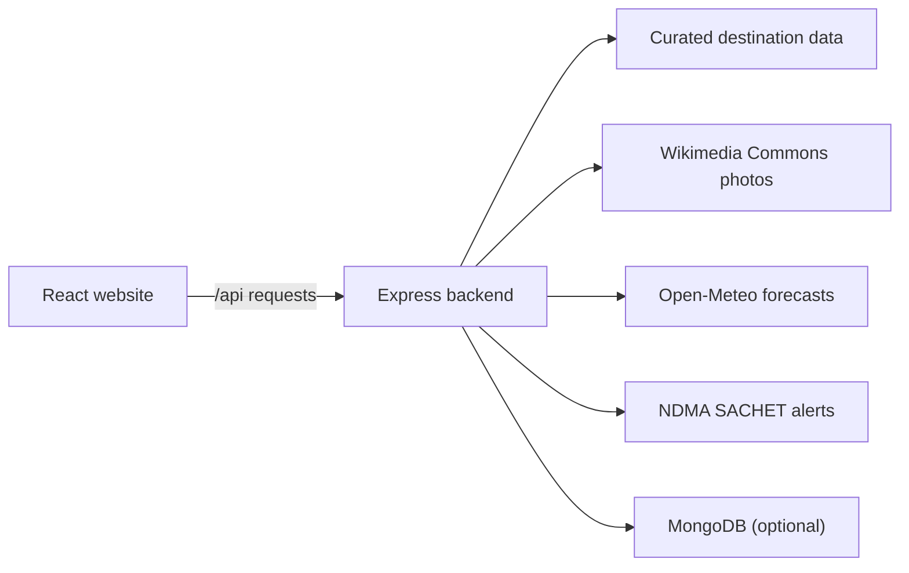

# Devbhoomi Yatra

A Uttarakhand travel guide with destination browsing, trip suggestions, weather and public alerts.

## Run locally

You need Node.js 18 or newer. Open two terminals in the project folder.

**Terminal 1 — backend**

```powershell
cd backend
npm install
Copy-Item .env.example .env
npm run dev
```

The API runs at `http://localhost:5000`. Edit `backend/.env` only if you need optional services such as MongoDB, email verification, or the AI trip summary.

**Terminal 2 — website**

```powershell
cd frontend
npm install
npm run dev
```

Open the local address printed by Vite (usually `http://localhost:5173`). The development server forwards `/api` requests to the backend.

## How it fits together



## Destination photos

- Each destination is searched separately using its name and district; the search prefers nature, landscape, and outdoor photos.
- The home-page Auli mountain photo rotates through its available, credited matches every two minutes. If only one photo is available, it remains in place.
- A destination does not reuse one district-wide image for every place. If a relevant, attributed match is unavailable, the tile shows a photo-unavailable fallback instead of an unrelated image.
- Image search uses Wikimedia Commons and caches results for up to six hours. Check each linked file page to confirm the subject, author, and license; Commons metadata is not always complete.
- Google Maps photos are not scraped. Showing Google Maps/Places photos requires using Google's approved APIs and following their billing, attribution, and display requirements.

## Data notes

- Destination details are curated; coordinates, altitudes, seasons, and access information may be approximate. Confirm routes, permits, opening times, and conditions locally.
- Weather comes from [Open-Meteo](https://open-meteo.com/) and alerts come from [NDMA SACHET](https://sachet.ndma.gov.in/). A missing alert feed or forecast does not mean conditions are safe.
- Adventure activities are a guide, not a live availability or safety feed. Use authorized providers and check current local rules.
- The trip recommender matches destination tags and listed best months. It is not a trained machine-learning model.
- User and report records persist only when `MONGODB_URI` is configured. Otherwise, the backend uses temporary memory and data is lost when it restarts.

## Keep secrets safe

Store private values in `backend/.env`. Never commit `.env`, API keys, email credentials, or database connection strings.
